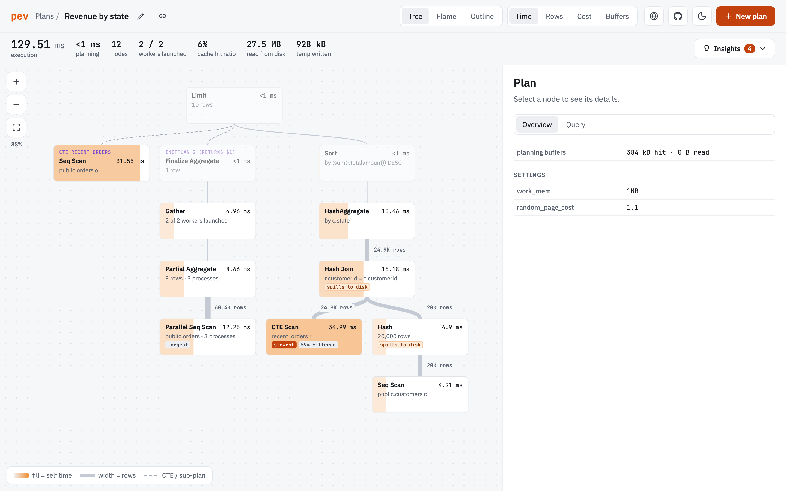

# Postgres Explain Visualizer (pev)

Postgres Explain Visualizer (pev) is designed to make [EXPLAIN](https://www.postgresql.org/docs/current/sql-explain.html) output easier to grok. It creates a graphical representation of the plan. You can read about it [on my blog](http://tatiyants.com/postgres-query-plan-visualization/).

Pev is heavily influenced by the excellent [explain.depesz.com](https://explain.depesz.com/).



## Features

- three views of a plan: a zoomable **tree** (cards shaded by the chosen metric, links sized by rows), a **flame chart** of where the time went, and an **outline** that fits phone screens
- graph time, rows, cost or buffers across the whole plan
- plain-language findings, like filters that throw away most of their rows, hashes and sorts that spill to disk, bad row estimates and cold caches
- a details panel for each node: self vs. total time, estimates, filters, buffers, parallel workers, and the matching part of the SQL query
- accepts plans in JSON or text format, pasted straight from psql, pgAdmin, DBeaver and friends, or from `auto_explain` log entries (which bring the query along)
- opens plans from a link, so scripts can send a plan straight to pev, and any plan can be shared as a link
- understands parallel query (Gather / Gather Merge and their workers), CTEs, InitPlans and SubPlans, and attributes their time to the node that ran them
- light and dark themes, and layouts for desktop, tablet and phone

For best results, generate plans with:

```sql
EXPLAIN (ANALYZE, COSTS, VERBOSE, BUFFERS, SETTINGS, FORMAT JSON) <your query>;
```

Plans are stored in your browser's localStorage and never leave your machine.

## Opening a plan from a link

`https://tatiyants.com/pev/#/import?plan=...&query=...&name=...` opens a plan directly. Everything after the `#` stays in the browser: it is never sent to the server. `plan` and `query` take plain URI-encoded text, or use `plan_gz` and `query_gz` for gzipped, base64-encoded values, which keeps links to big plans short. For example, from a shell:

```bash
psql -XqAt -c "EXPLAIN (ANALYZE, BUFFERS, VERBOSE, FORMAT JSON) SELECT ..." > plan.json
open "https://tatiyants.com/pev/#/import?plan_gz=$(gzip -c plan.json | base64 | tr -d '\n' | tr '+/' '-_' | tr -d '=')"
```

The link button next to a plan's name copies such a link for any plan you have open.

## Development

Pev is a [React](https://react.dev/) + [TypeScript](https://www.typescriptlang.org/) app built with [Vite](https://vite.dev/). It requires Node 20 or later.

```
npm install
npm run dev
```

Other scripts:

- `npm test` runs the unit tests ([Vitest](https://vitest.dev/))
- `npm run typecheck` type-checks the project
- `npm run build` produces a static build in `dist/` that can be hosted anywhere (it uses relative paths, so it works under a sub-path like `/pev/`)

The interesting code lives in `src/lib`:

- `parse.ts` and `textParser.ts` turn JSON or text EXPLAIN output into a common shape
- `analyze.ts` computes per-node metrics (exclusive time, buffers, estimates) and tags outliers
- `insights.ts` turns the analysis into plain-language findings
- `layout.ts` and `flame.ts` lay out the tree and flame views
- `highlight.ts` maps plan nodes back to the SQL query
- `share.ts` reads and builds plan links
